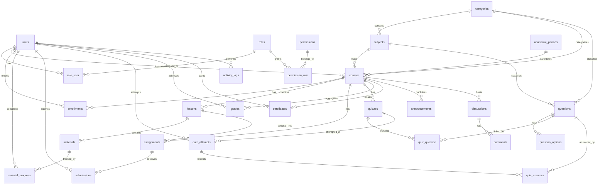

# VerdantLMS - Smart Learning Management System

VerdantLMS adalah platform Smart Learning Management System (LMS) berbasis web yang dibangun menggunakan **Laravel 12**, **Vue 3 (Composition API + TypeScript)**, **Inertia.js**, **MySQL**, **Tailwind CSS v4**, **Pinia**, **Chart.js**, **Lucide Vue Next**, **DomPDF**, dan **OpenSpout**.

Platform ini dirancang dengan arsitektur modular yang bersih, Role-Based Access Control (RBAC) untuk tiga peran utama (**Administrator**, **Pengajar/Dosen**, dan **Siswa/Mahasiswa**), penyimpanan file privat terotorisasi, bank soal & sistem ujian berbasis timer/autosave, rekap nilai berbobot otomatis, sertifikat terverifikasi publik, serta dukungan Light Mode & Dark Mode (WCAG AA).

---

## Arsitektur & Stack Teknologi

- **Backend:** PHP 8.2+, Laravel 12 (`app/Services`, `app/Policies`, `app/Http/Requests`, `app/Http/Controllers`, `app/Http/Middleware`, `app/Notifications`), Laravel Sanctum 4 (REST API `/api/*`)
- **Frontend:** Vue 3 `<script setup lang="ts">`, Inertia.js v3 (`@inertiajs/vue3` ^3.11 + `inertiajs/inertia-laravel` ^3.7), TypeScript, Pinia, Tailwind CSS v4, Lucide Icons, Chart.js (`vue-chartjs`)
- **Database:** MySQL / MariaDB dengan foreign key constraints, composite unique indexes, indexing, dan soft deletes
- **Ekspor & Dokumen:** `barryvdh/laravel-dompdf` (Laporan PDF & Sertifikat PDF), `openspout/openspout` (Ekspor `.xlsx`)
- **Notifikasi & API:** Database Notifications (`notifications`) + REST API berbasis Sanctum token (`/api/*`) untuk klien mobile/eksternal (terintegrasi opsional dengan Laravel Echo / Pusher)

---

## Entity Relationship Diagram (ERD)



---

## Fitur Utama per Modul

### 1. Modul Administrator (`/admin/*`)
- Dashboard statistik menyeluruh (pengguna, kelas aktif, materi, tugas, ujian, grafik tren pendaftaran & keaktifan 7 hari).
- Manajemen pengguna lengkap: CRUD, pencarian, filter peran/status, pagination server-side, aktivasi/nonaktifkan akun, reset password.
- Manajemen master akademik: Kategori, Mata Pelajaran, Periode Akademik, dan pengawasan seluruh Kelas.
- Manajemen Pengumuman Global, Monitoring Log Aktivitas (`activity_logs`), Ekspor Laporan Pembelajaran (`.pdf` & `.xlsx`), serta Pengaturan Aplikasi & Branding.

### 2. Modul Pengajar / Dosen (`/instructor/*`)
- Dashboard tugas menunggu penilaian, essay menunggu koreksi, dan statistik peserta per kelas.
- Pembuatan & pengelolaan kelas, regenerasi kode gabung kelas, manajemen peserta manual, serta konfigurasi bobot nilai (Tugas / Kuis / Ujian) & syarat kelulusan sertifikat.
- Struktur Bab/Pertemuan dan unggah materi privat (PDF, PPT, DOCX, gambar, video upload/URL, artikel teks, tautan eksternal).
- Manajemen tugas (lampiran, deadline, toleransi keterlambatan) serta pemeriksaan & pemberian nilai/feedback.
- Bank Soal terpusat (Pilihan Ganda, Benar-Salah, Essay) beserta tingkat kesulitan & pembahasan.
- Kuis & Ujian dengan randomisasi soal/opsi, durasi, jadwal, batas percobaan, KKM, dan penilaian essay manual.
- Buku Nilai per kelas dengan perhitungan nilai akhir otomatis & feedback pengajar, pengumuman kelas, serta forum diskusi.

### 3. Modul Siswa / Mahasiswa (`/student/*`)
- Dashboard pembelajaran, grafik progress per kelas, daftar tugas mendatang, dan form cepat gabung kelas via kode.
- Akses materi terstruktur (streaming PDF/gambar/video privat terotorisasi, unduh dokumen, tandai selesai untuk menghitung progress).
- Pengumpulan tugas teks maupun unggah file privat beserta pemantauan status dan nilai/feedback.
- Pengerjaan Kuis/Ujian dengan countdown timer tersinkronisasi server, autosave berkala & otomatis saat berpindah soal, auto-submit ketika waktu habis, serta halaman hasil & pembahasan.
- Rekap nilai, forum diskusi kelas, notifikasi, dan sertifikat PDF dengan hash verifikasi publik (`/certificates/verify/{hash}`).

---

## Persyaratan Sistem

- PHP `>= 8.2` (ekstensi: `pdo_mysql`, `mbstring`, `openssl`, `fileinfo`, `zip`, `xml`)
- Composer `>= 2.6`
- Node.js `>= 20.17` & npm
- MySQL `>= 8.0` atau MariaDB `>= 10.4`

---

## Panduan Instalasi & Konfigurasi

1. **Clone / masuk ke direktori proyek dan install dependensi backend:**
   ```bash
   composer install
   ```

2. **Install dependensi frontend dan build aset Vite:**
   ```bash
   npm install
   npm run build
   ```

3. **Konfigurasi file environment (`.env`):**
   Salin `.env.example` menjadi `.env` jika belum ada, lalu sesuaikan koneksi database MySQL:
   ```env
   APP_NAME=VerdantLMS
   APP_URL=http://127.0.0.1:8000
   APP_TIMEZONE=Asia/Jakarta
   LMS_DEMO_MODE=true

   DB_CONNECTION=mysql
   DB_HOST=127.0.0.1
   DB_PORT=3306
   DB_DATABASE=verdant_lms
   DB_USERNAME=root
   DB_PASSWORD=

   QUEUE_CONNECTION=sync
   SANCTUM_EXPIRATION=43200
   ```
   > Set `LMS_DEMO_MODE=false` pada environment production agar shortcut akun demo tidak tampil di halaman login dan seeder demo tidak ikut berjalan.

4. **Generate application key, jalankan migrasi, storage link, dan seeder demo:**
   ```bash
   php artisan key:generate
   php artisan migrate --force
   php artisan storage:link
   php artisan db:seed --force
   ```

5. **Jalankan server pengembangan:**
   ```bash
   php artisan serve
   ```
   Akses aplikasi melalui `http://127.0.0.1:8000`.

6. *(Opsional)* **Scheduler Deadline Reminder & Queue:**
   - Untuk menjalankan pengingat tenggat tugas secara terjadwal (`routes/console.php`):
     ```bash
     php artisan lms:send-deadline-reminders
     php artisan schedule:work
     ```
   - Jika menggunakan queue driver selain `sync`, jalankan worker:
     ```bash
     php artisan queue:work
     ```

---

## Akun Demo

Seluruh akun demo menggunakan password: **`Password123!`**

| Role | Email | Deskripsi |
| :--- | :--- | :--- |
| Administrator | `admin@verdantlms.test` | Akses penuh modul admin, pengguna, master data, dan ekspor laporan |
| Pengajar / Dosen | `dosen@verdantlms.test` | Pengampu kelas demo dengan materi, tugas, ujian, dan bank soal |
| Pengajar 2 | `pengajar2@verdantlms.test` | Akun pengajar tambahan untuk pengujian isolasi otorisasi |
| Siswa / Mahasiswa | `siswa@verdantlms.test` | Terdaftar di kelas demo dengan progress, nilai, dan ujian |

---

## Pengujian Otomatis

Jalankan seluruh Unit Test & Feature Test serta pengecekan tipe TypeScript:

```bash
php artisan test
npx vue-tsc --noEmit
npm run build
```
